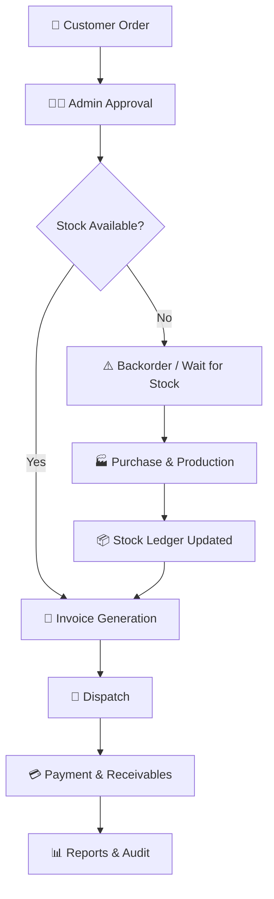

🏭 FactoryFlow
From Order to Audit — All in One Flow
A connected operations platform for small food-manufacturing businesses.

🌐 Live Demo · 💻 Source Code

📌 Table of Contents

<b>Navigate the README</b>
- ✨ Project Overview
- 🔄 End-to-End Workflow
- 🚀 Features
- 🧰 Technology Stack
- ⚙️ Installation and Setup
- 👥 Demo Login Accounts
- 📊 Benchmark Results
- 🧮 Business Logic
- 🧪 Run the Benchmark
- 🧩 Section 6 Capability Mapping
- ⚠️ Assumptions and Known Gaps
- 📁 Project Structure

✨ Project Overview
FactoryFlow brings the key activities of a food-manufacturing business into one connected application. It links customer orders, purchasing, inventory, BOM-based production, invoicing, dispatch, payments and audit reporting.

Instead of treating each activity as a separate process, FactoryFlow connects them through shared business records and an inventory ledger.
🎯 The problem it addresses
Small manufacturing businesses may track orders, raw materials, production usage, finished goods and payments in separate records. This makes it harder to identify stock shortages, material wastage, production variance, actual product cost and outstanding payments.
💡 The solution
FactoryFlow provides a common workflow with stock movements, production records, invoice calculations and reports that help users follow an order from creation through dispatch and audit.
🔄 End-to-End Workflow

Diagram shows the high-level business flow; exact actions are subject to role permissions and stock availability.
🚀 Features
Module	What it does
🛒 Sales Management	Create salesman orders, review and approve orders, generate invoices and track customer receivables.
📦 Inventory Management	Track raw materials, packaging and finished goods through stock-ledger movements.
🧾 Purchase Management	Record purchase receipts and increase available inventory.
🏭 Production Management	Calculate planned BOM requirements, capture actual material usage and record good/damaged output.
📉 Variance Analysis	Compare planned and actual material consumption and production yield.
💰 Product Costing	Combine material issue cost, labour and power cost to calculate cost per good packet.
🇮🇳 GST Invoicing	Calculate CGST/SGST for intra-state sales and IGST for inter-state sales.
🔐 Role-Based Access	Restrict supported actions according to the user's role.
📴 Offline Order Capture	Cache app resources and selected data; queue order submissions for retry.
🧾 Audit and Reports	Provide audit records and reports for sales, GST, stock, production, purchases and outstanding balances.

📊 Reports available
- Sales report
- GST report
- Stock report
- Ledger report
- Production report
- Outstanding report
- Purchase report
- Customer-wise report
- Product-wise report
🧰 Technology Stack
Technology	Where it is used	Why it was selected
🐍 Python 3.9+	HTTP server and backend business logic	Simple, readable implementation with no third-party runtime dependencies.
🗃️ SQLite	Relational database	Lightweight persistence suitable for a small single-instance demonstration.
🌐 HTML, CSS and JavaScript	Browser interface	Provides a responsive browser UI without requiring a frontend build toolchain.
🐳 Docker	Containerization	Makes the application easier to run consistently in local and hosted environments.
📱 Service Worker / PWA approach	Offline support	Caches app resources and supports queued order submission when connectivity returns.

Data precision
- Inventory quantities are stored as integer base units such as grams, millilitres or pieces.
- Currency is stored as integer paise.
- Decimal arithmetic is used when converting entered quantities and amounts to these stored units.
This reduces floating-point rounding errors in stock and financial calculations.
⚙️ Installation and Setup
Prerequisites
- Python 3.9 or later
- Git
- A modern web browser
1. Clone the repository
git clone https://github.com/tharshini1/factory_flow.git
cd factory_flow/murukku-ops
2. Start the application
python server.py
3. Open the application
Visit:
http://localhost:8000
The application seeds demonstration data on first startup.
🐳 Run with Docker
cd murukku-ops
docker compose up --build
Then open the local URL exposed by the container.
☁️ Deployment note
The project includes a Dockerfile for container-based deployment. On Render, configure the service to use Docker and the platform-provided PORT environment variable.

Database persistence: a hosted service's local filesystem may be ephemeral. For persistent SQLite data on Render, attach a persistent disk and configure:
DB_PATH=/var/data/factory.db
👥 Demo Login Accounts
The application includes seeded demonstration accounts.
Username	Role
sales_a	Salesman
sales_b	Salesman
admin	Admin
production	Production
auditor	Accountant / Auditor
owner	Owner

Demo password: demo123
⚠️ These credentials are for demonstration only. Do not use them in a production deployment.

📊 Benchmark Results
The repository's automated benchmark test asserts the following end-to-end scenario values.

Benchmark check	Expected result
🌾 Flour closing stock	120 kg
🛢️ Cooking oil closing stock	19.5 L
🛍️ 200 g pouch closing stock	306 pcs
📦 Finished goods after production	238 packets
📉 Production yield variance	−6.0%
🛢️ Cooking-oil usage variance	+5.0%
🚚 Finished goods after dispatch	88 packets
🧾 Invoice taxable value	₹7,500.00
CGST	₹187.50
SGST	₹187.50
💳 Invoice total	₹7,875.00
Outstanding after ₹4,000 payment	₹3,875.00
⚠️ Distributor B shortage	32 packets
💰 Production cost per good packet	₹31.14

🔍 Explanation of benchmark differences

<b>💰 Why is the production cost ₹31.14 per packet?</b>
The benchmark run records:
- Material cost = ₹4,055
- Labour cost = ₹1,200
- Power cost = ₹600
Total run cost:

₹4,055 + ₹1,200 + ₹600 = ₹5,855

Good output = 188 packets.

₹5,855 / 188 = ₹31.1436...

Rounded cost per good packet = ₹31.14.

<b>📉 Why is yield variance −6%?</b>

Expected output = 200 packets.

Actual good output = 188 packets.

((188 − 200) / 200) × 100 = −6%

The run produced 12 fewer good packets than expected.

<b>🛢️ Why is cooking-oil variance +5%?</b>

Planned oil consumption = 10 L.

Actual oil consumption = 10.5 L.

((10.5 − 10) / 10) × 100 = +5%

Actual consumption exceeded the planned quantity by 0.5 L.

<b>📦 Why is pouch variance not flagged at −3%?</b>

The implementation flags a variance only when its absolute value is greater than 3%. A variance exactly equal to 3% is at the tolerance boundary, so it is not flagged. A carton variance of −10% is flagged.

<b>🧮 Why is flour not valued at the latest purchase price?</b>

FactoryFlow uses moving weighted-average valuation. For example:

(100 kg × ₹42 + 60 kg × ₹45) / 160 kg = ₹43.125/kg

Therefore, the issue value reflects the weighted average of stock value and quantity, not only the latest receipt price.

<b>🧾 Why are CGST and SGST applied?</b>

The benchmark customer is in Tamil Nadu, the factory's home state. The 5% GST is split equally into CGST (2.5%) and SGST (2.5%).

For the Karnataka customer, the invoice uses IGST because the sale is inter-state.

<b>🚚 Why is Distributor B short by 32 packets?</b>

The order quantity exceeds the available finished-goods stock by 32 packets. The order can be approved as a backorder, but dispatch is blocked until sufficient stock is available.

Benchmark status: These are the expected values asserted in tests/test_benchmark.py. Run the benchmark command below and retain its terminal output as execution evidence. Do not treat expected assertions as a successful run until the test passes.

🧮 Business Logic
1. Stock calculation
Stock on hand is derived from the sum of ledger quantity movements:
Closing Stock = Sum of all signed stock movements
- Purchase receipt → positive movement
- Material issue to production → negative movement
- Production output → positive finished-goods movement
- Customer dispatch → negative finished-goods movement
- Credit-note reversal → reversal movement
2. BOM planned consumption
For each raw material:
Planned Quantity = BOM Quantity per Batch × Number of Batches
Actual material consumption is captured for the production run. Pouch usage is derived from good packets plus damaged packets.
3. Material variance
Variance (%) = ((Actual − Planned) / Planned) × 100
A flag is raised when the absolute variance is greater than 3%.
4. Yield variance
Yield Variance (%) =
((Good Output − Expected Output) / Expected Output) × 100
5. Cost per good packet
Run Cost = Material Issue Cost + Labour Cost + Power Cost

Cost per Good Packet = Run Cost / Good Packets
6. Inventory valuation
FactoryFlow uses perpetual moving weighted-average valuation. The average cost is calculated from the current inventory value and quantity, together with the value and quantity of new receipts. Material issues use the current average cost.
🧪 Run the Benchmark
From the project folder:
python tests/test_benchmark.py
The benchmark starts the application against a temporary SQLite database, calls the HTTP API and checks expected end-to-end values.

It is a functional workflow/regression benchmark, not a performance benchmark. It does not measure throughput, latency, concurrency or production-scale reliability.
🧩 Section 6 Capability Mapping
The repository contains implementation evidence for the capability areas below. The exact Section 6 tier names and numbering were not included in the repository materials used to prepare this README. The mapping is therefore by capability; align the labels and tier numbers with the assignment brief before final submission.
Capability area	Implemented functionality
🛒 Order-to-cash	Sales order creation, admin approval, invoice generation, dispatch, payment and outstanding balance
🧾 Purchase-to-stock	Purchase receipts create positive stock-ledger movements
🏭 BOM-based production	BOM planning, actual consumption, good/damaged output and production ledger postings
📉 Variance and alerts	Yield and material variance calculations; flags above 3% tolerance
💰 Costing	Material issue value plus labour and power overhead; cost per good packet
🇮🇳 GST and documents	HSN/rate invoice lines, intra/inter-state tax split, invoice numbering and credit-note cancellation
📊 Audit and reporting	Audit log and nine report endpoints
📴 Offline workflow	Cached app shell/product/customer data and idempotent queued order submission
🔐 Role-based access	Server-side endpoint authorization for defined roles

⚠️ Assumptions and Known Gaps
Assumptions
- The demonstration represents one factory.
- Tamil Nadu is treated as the factory's home state for GST classification.
- Item quantities are normalized to configured base units.
- Each production run is for one finished product.
- Labour and power costs are assigned directly to the production run.
- Finished-goods overhead is absorbed through a value-only ledger movement (zero quantity).
- Seed data and demo credentials are intended only for evaluation.
Known gaps
- No batch/lot traceability or expiry-date management.
- No GPS/geolocation workflow.
- Supplier master data is free text rather than a normalized supplier entity.
- No partial dispatch or general sales-return workflow; invoice cancellation/credit-note reversal is implemented.
- Session tokens do not expire.
- Password hashing uses a fixed application prefix plus SHA-256 and is demo-grade, not production-grade.
- SQLite is suitable for this demonstration, not a hardened multi-user production ERP.
- The benchmark is functional and deterministic; it does not measure load, latency or concurrency capacity.
