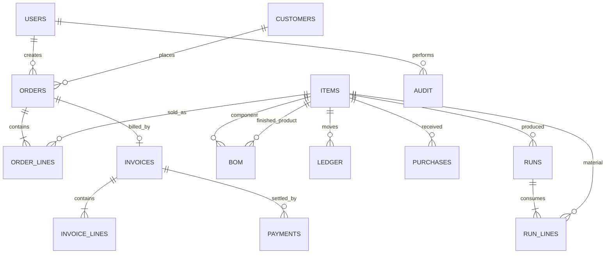

# FactoryFlow — Design Note

**Scope:** order-to-audit workflow for a small food-manufacturing operation. This note describes the SQLite schema and calculations implemented in `server.py`.

## 1. Data model

**Core entities:** `users` and `sessions` handle identity; `customers` and `orders` represent demand; `order_lines`, `invoices`, `invoice_lines` and `payments` represent billing and collections; `items` and `bom` define inventory and recipes; `purchases` record receipts; `runs` and `run_lines` record production; `ledger` is the inventory movement/value source of truth; `audit` records user actions.

An `items` row is classified as raw material, packaging or finished good. `bom(product_id, item_id, qty, role)` links a finished product to required components. `ledger` records signed quantity and value movements with a document type/id reference. Production run lines retain planned quantity, actual quantity and issued material value.

## 2. Stock and BOM consumption

### Stock balance

For item *i*, the on-hand quantity and inventory value are derived from all ledger entries:

\[
Q_i = \sum_j q_{ij}, \qquad V_i = \sum_j v_{ij}
\]

Positive quantity means receipt/production; negative quantity means issue/dispatch. The ledger is append-only in normal workflows, so purchases, production issues, production receipts, dispatches and credit-note reversals remain traceable. Quantities are stored as integer base units (grams, millilitres or pieces); each item has a conversion factor for display units.

### Planned and actual BOM

For a run of *B* batches, component *k* has:

\[
Planned_k = BOMQty_k \times B
\]

Actual consumption is entered for each ingredient. Packaging pouches are calculated as `good packets + damaged packets`. The application checks that actual consumption does not exceed available stock, then posts a negative ledger movement for each consumed component and a positive finished-goods movement for good output.

Material variance is:

\[
Variance_k(\%) = \frac{Actual_k-Planned_k}{Planned_k}\times100
\]

Yield variance is:

\[
Yield(\%) = \frac{Good-Expected}{Expected}\times100
\]

The configured tolerance is 3.00%. A flag is raised only when the absolute variance is **greater than** 3%; a value exactly at ±3% is not flagged.

## 3. Costing and inventory valuation

### Perpetual weighted-average material valuation

The application uses a moving/perpetual weighted-average cost. After a receipt, the item's average cost is:

\[
AverageCost_i = \frac{CurrentValue_i + ReceiptValue_i}
                     {CurrentQty_i + ReceiptQty_i}
\]

A material issue is valued at the current average cost (rounded to integer paise). In code, the issue value is calculated from the ledger's current total value and quantity. This is why a benchmark issue is not valued at only the latest supplier purchase price.

Example from the project README: flour's average is `(100 kg × ₹42 + 60 kg × ₹45) / 160 kg = ₹43.125/kg`.

### Production cost per good packet

The run's total cost is:

\[
RunCost = MaterialIssueCost + Labour + Power
\]

\[
CostPerGoodPacket = \frac{RunCost}{GoodPackets}
\]

Labour and gas/power are entered against the run and capitalized into finished-goods inventory through a value-only ledger row (quantity zero). The per-packet metric divides total run cost by **good** output, not good plus damaged output. This is a single-product run model; a multi-product factory would need a documented overhead allocation basis (for example machine-hours or output value).

### Benchmark calculation

The benchmark scenario records material cost ₹4,055, labour ₹1,200 and power ₹600:

\[
₹(4,055+1,200+600) / 188 = ₹31.1436\ldots \approx \mathbf{₹31.14}
\]

The automated test asserts this value. The test also checks stock balances, yield/material variances, GST split, dispatch shortage, receivable balance, reports, offline retry idempotency, credit-note stock reversal and audit logging.

## 4. Boundaries / limitations

The current model does not implement lot/expiry tracking, partial dispatch, general sales returns, GPS, or a normalized supplier master. Session expiry and production-grade password hashing are also absent. The SQLite/demo deployment should therefore be treated as an evaluation prototype rather than a hardened production ERP.
